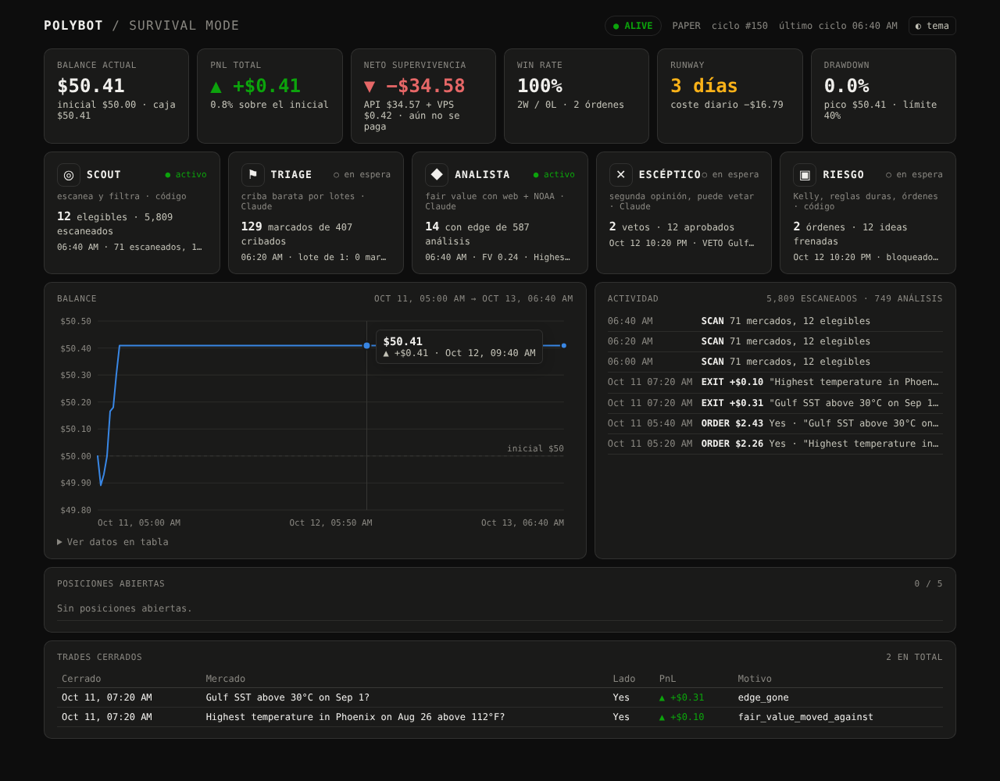

# Polybot — agente autónomo de trading en Polymarket

Agente que corre 24/7, escanea Polymarket cada 10 minutos, usa **Claude** (`claude-opus-5-5`, con búsqueda web)
para estimar el *fair value* de cada mercado y opera solo cuando el edge supera 8 puntos, con
**1/4 Kelly** y reglas de riesgo que no se pueden saltar.

- **Modo por defecto: Paper Trading con $50.** Simula cada orden contra el libro de órdenes real del CLOB.
- **Live Trading** solo si lo activas a propósito (dos llaves: `TRADING_MODE=live` + `LIVE_TRADING_CONFIRM=yes`).
- Todo queda registrado: cada mercado evaluado, cada edge, cada trade, cada balance.
- **Equipo de 5 agentes:** Scout → Triage → Analista → Escéptico → Riesgo (ver abajo).
- **TURBO ("modo minero"):** muchos trades pequeños, todo el rato, dentro de las reglas duras.
- **Modo tiempo:** prioriza mercados meteorológicos y le da a Claude la previsión oficial de NOAA/NWS.
- **Panel web en directo:** balance, PnL, coste diario, runway, log de órdenes y posiciones.

> ⚠️ **Antes de usarlo.** Polymarket no está permitido en todas las jurisdicciones y bloquea operar desde
> algunos países. Comprueba que es legal donde vives y que el VPS está en una región permitida; no uses VPN
> para saltarte un bloqueo. Esto no es asesoramiento financiero: con $50 puedes perderlo todo.

---

## Cómo funciona

```
cada 10 min
 ┌──────────────────────────────────────────────────────────────────────┐
 │ 1. Sincroniza caja · liquida mercados resueltos · valora posiciones  │
 │ 2. ¿Drawdown ≥ 40% desde el pico? → PARA, escribe post-mortem, espera │
 │ 3. Gamma API: hasta 1.000 mercados activos                           │
 │ 4. Filtro: liquidez > $5k, volumen, resuelve en > 2 h, fuente oficial │
 │ 5. Revisa posiciones: sale si edge < 2 pp, FV −5 pp, o resuelve ya   │
 │ 6. Equipo: Triage → Analista → Escéptico → Riesgo (ver abajo)        │
 │       edge = fair value − precio de compra (ask)                     │
 │       edge > 8 pp → 1/4 Kelly (tope 6%) → reglas → orden             │
 │ 7. Guarda estado, logs, status.md                                    │
 └──────────────────────────────────────────────────────────────────────┘
```

### El equipo de 5 agentes

```
1.000 mercados
   │
   ▼
 SCOUT ───── código ────── filtra (liquidez, volumen, < 2 h, fuente oficial) y ordena:
   │                       primero mercados del tiempo y los que resuelven antes
   ▼  ~100–300 elegibles
 TRIAGE ──── Claude ────── criba barata por lotes de 25, sin búsqueda web (~$0,003/mercado):
   │                       marca los que parecen mal valorados
   ▼  ~1 de cada 5
 ANALISTA ── Claude ────── fair value a fondo: búsqueda web + previsión oficial de NOAA
   │
   ▼  solo si edge > 8 pp y pasa las reglas
 ESCÉPTICO ─ Claude ────── busca por qué el mercado tiene razón; puede VETAR.
   │                       Si aprueba: fair value final = media de las dos opiniones
   ▼  solo si sigue habiendo edge > 8 pp con la media
 RIESGO ──── código ────── 1/4 Kelly, tope 6%, máx. 5 posiciones, simula el fill en el libro,
                           ejecuta y vigila salidas
```

Por qué está montado así:
- **Triage** es lo que permite operar mucho: mira cientos de mercados al día por céntimos, y el análisis caro
  solo se gasta en los prometedores.
- **Escéptico** ataca el mayor problema que salió en la simulación: Claude cree ver ventaja donde solo hay ruido.
  Una segunda opinión independiente que intenta tumbar la idea, y promediar las dos, reduce las entradas falsas.
- **Riesgo** es código y es el único con "manos". Ningún agente de IA puede colocar una orden ni saltarse una regla.
- En las posiciones abiertas el fair value es una **media móvil** (`FV_SMOOTHING`), para que una sola
  re-estimación con ruido no fuerce una venta (y pagar el spread otra vez).

El panel muestra una tarjeta por agente con lo que ha hecho: mercados cribados y marcados, análisis, vetos,
órdenes e ideas frenadas.

### Agente CUOTAS: deportes frente a Pinnacle (`SHARP_ENABLED=true`)

Lo que hacen muchos traders de deportes que ganan: las cuotas de **Pinnacle**, sin el margen de la casa, son una de las
mejores estimaciones públicas de la probabilidad real de un partido. Cuando Polymarket se desvía de ellas, la ventaja
suele estar del lado de Pinnacle. El agente CUOTAS (`polybot/sharp.py`):

1. Descarga las cuotas de Pinnacle de los deportes de `SHARP_SPORTS` (The Odds API) cada `SHARP_REFRESH_MINUTES`.
2. Les quita el margen de la casa (normalización multiplicativa) para tener probabilidades justas.
3. Empareja cada mercado de Polymarket (ganador, empate, más/menos, hándicap) con su partido: mismos dos equipos
   (con nombres normalizados: "FC Bayern München" = "Bayern Munich", pero "AC Milan" ≠ "Inter Milan") y hora de
   inicio con menos de 3 h de diferencia.
4. Edge = probabilidad de Pinnacle − precio real de compra en el CLOB − comisión de Polymarket.
5. **Opera solo con las reglas duras** (edge > 8 pp, 1/4 Kelly, 6%...). Va antes que Claude, así que no gasta en la API.
6. **Registro en la sombra:** cada desvío ≥ `SHARP_SHADOW_EDGE` (2 pp) se guarda en `decisions.jsonl` aunque no se opere.
   `python -m polybot report` calcula, cuando los partidos terminan, cuánto habría ganado apostar $1 a esos desvíos con
   cada umbral (2, 4, 6, 8 pp). Así se mide la estrategia sin romper las reglas.

Las posiciones abiertas por CUOTAS se revisan con Pinnacle, sin llamar a Claude.

**Puesta en marcha:** crea una clave en https://the-odds-api.com, ponla en `ODDS_API_KEY` y activa `SHARP_ENABLED=true`.
Si el bot corre en un entorno con red restringida, permite el dominio `api.the-odds-api.com`. El plan gratuito
(~500 créditos/mes) da para pocos días con la configuración por defecto (ver `.env.example`).

### TURBO: "modo minero" (`TURBO=true`, activado en `.env.example`)

Picar poco a poco, pero todo el rato: muchas apuestas pequeñas ($1–3 con $50) en mercados que resuelven en días,
para que el capital vuelva rápido y se reinvierta. TURBO sube el volumen sin tocar las reglas duras:

| | Normal | TURBO |
|---|---|---|
| Mercados que resuelven en | ≤ 60 días | **≤ 7 días** |
| Cribados por ciclo (triage) | 50 | **150** |
| Análisis a fondo por ciclo | 4 | **10** |
| Re-criba de un mercado | 6 h | **2 h** |
| Presupuesto Claude / día | $3 | **$10** (triage $2) |
| Esfuerzo analista / escéptico | high / medium | medium / low (más análisis por dólar) |

Estimación (no medida): con $10/día, unos 600–800 mercados cribados y 30–50 análisis completos al día. Cuántos
acaban en trade depende de cuántos tengan de verdad más de 8 puntos de edge. **Coste: hasta ~$300/mes de API.**
Con $50 de bankroll eso no se paga solo (ver la simulación). Baja `DAILY_API_BUDGET_USD` si quieres gastar menos.

**El límite de volumen lo ponen tus reglas.** Con máximo 5 posiciones y edge > 8 pp, el bot es un buscador de
pepitas más que un minero de migajas. Un "minero" de verdad (miles de operaciones con 1–2 puntos de ventaja)
sería un *market maker*: otra estrategia, con otra infraestructura, y que romperían esas dos reglas.

**Claude es el cerebro, pero no tiene las manos.** Claude solo devuelve una probabilidad (a través de una
herramienta con esquema estricto). El tamaño, el permiso para entrar y la orden los decide código
determinista en `risk.py`. Así ninguna respuesta del modelo puede romper una regla dura.

### Estructura

```
polymarket-bot/
├── polybot/
│   ├── __main__.py    CLI: run / once / status / scan / approve / reset
│   ├── agent.py       el ciclo de 10 minutos
│   ├── brain.py       agente ANALISTA (web + NOAA) y el bucle común de Claude
│   ├── agents.py      agentes TRIAGE y ESCÉPTICO
│   ├── sharp.py       agente CUOTAS: deportes frente a Pinnacle (The Odds API)
│   ├── scanner.py     escáner de ventaja en todo Polymarket
│   ├── weather.py     detección de mercados del tiempo + cliente de api.weather.gov
│   ├── dashboard.py   panel web en directo (+ dashboard.html)
│   ├── simulate.py    simulación Monte Carlo del bot
│   ├── backtest.py    backtest honesto de mercados de temperatura (Polymarket + Open-Meteo)
│   ├── report.py      informe del paper trading: Claude vs mercado, calibración, crecimiento mensual
│   ├── risk.py        Kelly fraccional, edge, reglas duras, drawdown
│   ├── filters.py     filtro de mercados elegibles
│   ├── polymarket.py  Gamma API + libros del CLOB (lectura)
│   ├── executor.py    Paper (simulado contra el libro real) y Live (py-clob-client)
│   ├── state.py       estado persistente (escritura atómica)
│   ├── journal.py     logs, diarios JSONL y status.md
│   ├── postmortem.py  informe automático al llegar al 40% de drawdown
│   └── config.py      configuración + límites duros
├── tests/             84 tests (reglas, Kelly, comisiones, filtros, ciclo, agentes, cuotas, NOAA, panel, TURBO, backtest, escáner, report)
├── deploy/            servicio systemd + instalador para VPS
├── Dockerfile, docker-compose.yml
└── .env.example
```

---

## Reglas duras (y dónde se aplican)

| Regla | Implementación |
|---|---|
| Máx. 6% del bankroll actual por posición | `risk.position_size_usd` — tope sobre la **equity** actual (caja + posiciones) |
| Máx. 5 posiciones abiertas | `risk.entry_blockers` + el agente deja de buscar entradas |
| Solo entrar con edge > 8 pp | Se comprueba **dos veces**: contra el mejor ask y contra el precio medio real de ejecución tras barrer el libro |
| 1/4 Kelly con tope del 6% | `f* = (p − precio)/(1 − precio)`, se usa `f*/4`, nunca más del 6% |
| Liquidez > $5.000 y fuente de resolución clara y oficial | Filtro determinista (`filters.py`) **y** Claude debe confirmar `resolution_source_clear=true` |
| Ignorar mercados que resuelven en < 2 h | `filters.py`; además las posiciones se cierran al quedar < 2 h |
| Drawdown 40% → parar, post-mortem, esperar aprobación | `agent._halt` + `postmortem.py`; solo `python -m polybot approve --yes` reanuda |
| Nunca añadir capital externo | El bankroll es contabilidad interna que arranca en $50. En live, la caja del bot **solo puede bajar** al saldo real de la wallet, nunca subir: si depositas más, el bot no lo usa |
| Loguear todo | Ver [Logs](#logs-y-estado) |

Los límites viven en `config.HARD_LIMITS`. Puedes hacerlos **más estrictos** por `.env`; si intentas
aflojarlos (p. ej. `MAX_POSITION_PCT=0.10`), el bot se niega a arrancar.

Filtros extra (más estrictos que el enunciado, ajustables): volumen 24 h ≥ $1.000, spread ≤ 5 pp, precio entre
3% y 97%, resolución en ≤ 60 días, confianza de Claude ≥ `medium`, tamaño ≥ mínimo del mercado (5 shares / $1).

---

## Arranque rápido (Paper Trading con $50)

Requisitos: Python 3.10+ y una API key de Claude (https://console.anthropic.com).

```bash
cd polymarket-bot
python3 -m venv .venv && source .venv/bin/activate
pip install -r requirements.txt
cp .env.example .env          # y pon tu ANTHROPIC_API_KEY
python -m polybot scan        # comprueba que llega a Polymarket (no gasta en Claude, no opera)
python -m polybot once        # un ciclo completo
python -m polybot run         # loop 24/7, un ciclo cada 10 minutos
```

Tests: `pip install -r requirements-dev.txt && pytest`

### Comandos

| Comando | Qué hace |
|---|---|
| `python -m polybot run` | Loop continuo. `Ctrl+C`/`SIGTERM` termina al acabar el ciclo |
| `python -m polybot once` | Un solo ciclo |
| `python -m polybot status` | Balance, pico, drawdown, posiciones, win rate, costes |
| `python -m polybot scan` | Lista los mercados que pasan el filtro |
| `python -m polybot dashboard` | Panel web en http://127.0.0.1:8080 |
| `python -m polybot report` | ¿Bate Claude al mercado? Brier, calibración, vetos y crecimiento mensual del paper trading |
| `python -m polybot backtest --days 90` | Backtest honesto de mercados de temperatura con datos históricos reales |
| `python -m polybot.simulate` | Simulación Monte Carlo (supuestos, no resultados) |
| `python -m polybot approve --yes --note "..."` | Reanuda tras una parada por drawdown (el pico pasa a ser la equity actual) |
| `python -m polybot reset --yes` | Solo paper: reinicia con el bankroll inicial |

---

## Modo tiempo y velocidad (`FAST_MODE=true`, por defecto)

Los mercados meteorológicos (temperatura máxima en una ciudad, lluvia, nieve, huracanes, tormentas con nombre)
resuelven en pocos días con datos oficiales, y las previsiones públicas a 1–3 días son buenas (unos 2–3 °F de
error en la máxima del día siguiente). Es el nicho con más opciones de encontrar ventaja real. Con `FAST_MODE`:

1. Los candidatos se ordenan con **los mercados del tiempo primero** y, dentro de cada grupo, **los que resuelven
   antes**. El capital vuelve antes y se reinvierte más veces (interés compuesto más rápido).
2. En mercados del tiempo, Claude recibe la herramienta `get_nws_forecast`: la previsión oficial de NWS a 7 días
   y la última observación de la estación más cercana (solo EE. UU.), además de la búsqueda web para avisos del NHC.

Las reglas duras no cambian. **¿Por qué no hacerlo más agresivo para ganar más rápido?** Simulado con las mismas
condiciones (`python -m polybot.simulate`), Kelly completo con hasta un 30% por apuesta y sin parada:

| Escenario | Reglas actuales | Agresivo |
|---|---|---|
| Claude con poca ventaja | mediana $47, 0% acaba con < $10 | mediana **$9**, **61% acaba con < $10** |
| Claude con mucha ventaja y mercados ineficientes | mediana $353 | mediana $1.143 (p10 $149, p90 $7.039) |

Ser agresivo solo compensa si la ventaja es real, y eso no lo sabremos hasta medirla. Si no lo es, te arruina.

---

## Backtest y verificación

**La trampa:** un backtest normal con Claude sale falso. Claude conoce el resultado de muchos eventos pasados (los vio
en su entrenamiento) y la búsqueda web devuelve noticias de hoy, incluido cómo acabó el mercado. Por eso hay dos
herramientas, y ninguna deja mirar al futuro:

### 1. `python -m polybot backtest` — mercados de temperatura, datos históricos reales, sin Claude

- **Precio** que tenía cada mercado en cada momento: historial del CLOB de Polymarket (`prices-history`).
- **Previsión tal como estaba publicada en ese momento:** Open-Meteo *Previous Runs* (para cada hora, la previsión
  emitida N días antes). El bot solo usa previsiones emitidas antes del momento de decidir (`required_lead`).
- **Resultado** de cada mercado: su resolución en Polymarket.
- Mismas reglas que el bot real (`risk.py`): edge > 8 pp, 1/4 Kelly, 6%, 5 posiciones, salidas y parada al 40%.
- **Walk-forward:** el sesgo y la dispersión del modelo se ajustan con el primer 40% de los días y se opera SOLO en el
  60% posterior, para no hacer trampa con los parámetros.
- Devuelve el Brier score de la previsión frente al precio del mercado (¿quién acierta más?), los trades, el PnL y el
  bankroll final. Se guarda en `data/backtest.md`.

Opciones: `--days`, `--bankroll`, `--spread` (súbelo para ver si el resultado aguanta costes peores), `--train-frac`.

Validado con mundos sintéticos donde se sabe la respuesta (`tests/test_backtest.py`):
- Si el mercado **ignora** la previsión, el backtest gana.
- Si el mercado **sabe más** que la previsión, el backtest pierde ($50 → $30) y salta la parada del 40%.

No está trucado para ganar.

**Trampa encontrada con datos reales (y corregida):** el historial de precios del CLOB da un "precio" también a los
rangos sin órdenes reales (el punto medio de un libro casi vacío). En los ~30.000 mercados de temperatura de un mes,
los precios de "Sí" de los 11 rangos de un evento sumaban de mediana un **181%** (deberían sumar ~100%). Con esos
precios, un primer backtest daba $50 → $256: falso. Por eso el backtest solo usa los instantes en que los rangos de un
evento suman entre 95% y 110% (`coherent_only`).

**Resultado real (solo precios, `run_price_backtest`, 30 días, 13.600 mercados con precios coherentes):** el mercado
está bien calibrado (cada tramo de precio acierta con la frecuencia que promete, ±3–5 pp de ruido). Corregir los
precios con lo aprendido no mejora el Brier (0,0538 vs 0,0535) y no aparece ningún trade con edge > 8 pp.
**Sin previsiones, no hay ventaja.**

**Resultado real con previsiones (13-oct-2026; eventos del 14-sep al 12-oct, 51 estaciones; test del 25-sep al 12-oct;
~7.800 mercados en test):**

| Variante | $50 → | Trades | |
|---|---|---|---|
| Reglas del bot, spread 2 pp | **$26,66** | 18 | toca la parada del 40% |
| Aguantar hasta resolver, spread 2 pp | $27,76 | 22 | |
| Reglas del bot, spread 4 pp | $27,66 | 16 | |
| Aguantar, spread 4 pp | $28,17 | 22 | |

El mercado acierta más que la previsión pública en todas las antelaciones (Brier, más bajo = mejor):
máximas a 2 días 0,078 (previsión) frente a 0,063 (mercado); a 3 días 0,081 frente a 0,066. Corregir el sesgo de cada
estación no lo cambia (0,0766 frente a 0,0535), y mezclar solo un 10% de previsión con el precio ya empeora el
resultado (0,0539). La previsión es correcta (error medio ~2,2–2,6 °F, lo normal), pero el mercado ya la descuenta
y sabe más. **Conclusión: con previsiones públicas no hay ventaja en estos mercados; el bot pierde dinero.**

Limitaciones: solo mercados de **temperatura diaria** de las ciudades de la tabla `STATIONS` (amplíala si hace falta);
spread supuesto; sin filtro de liquidez histórica. Si casi todo el beneficio viene de salidas anticipadas y no de mercados
resueltos, desconfía: puede ser rebote entre bid y ask. Necesita acceso a `gamma-api.polymarket.com`,
`clob.polymarket.com` y `previous-runs-api.open-meteo.com`. El plan gratuito de Open-Meteo tiene un cupo diario
por IP: si se agota, el backtest avisa y hay que repetirlo al día siguiente (lo descargado queda en caché).

### Escáner de todo Polymarket: `python -m polybot scan-edges`

Busca categorías (deportes, cripto, política, economía, cultura, tiempo) donde los precios fallen de forma
sistemática, con las mismas precauciones (selección por fecha de cierre programada, precios congelados e
incoherentes fuera, aprendizaje en el primer 40% y prueba en el resto).

**Resultado real (13-oct-2026; 37.857 mercados con volumen ≥ $10k, cierre programado entre el 13-sep y el 12-oct):**
- Cripto, política, economía, cultura, tiempo: precios bien calibrados; los descuadres del periodo de aprendizaje
  no se repiten en el de prueba (en cripto incluso cambian de signo).
- **Deportes:** sesgo persistente en los dos periodos y antes del partido. Los "underdogs" ganan más de lo que dice su
  precio y los favoritos menos. En partidos con volumen ≥ $50k, el tramo 12–30% gana +7,2 ± 2,9 pp; en mercados de
  más de $250k se reduce a +5 ± 5 pp (ya no significativo). En mercados poco líquidos es mayor, pero ahí el precio
  del historial (punto medio de libros anchos) exagera el efecto.
- **Con las reglas del bot (edge > 8 pp): 0 trades.** Con una regla hipotética de > 4 pp los resultados oscilan entre
  +5% y +72% según el spread y el bankroll, con solo ~15 trades: no es evidencia suficiente.
- Con $50, el tope del 6% ($3) y el mínimo de 5 participaciones impiden comprar cualquier lado que cueste más de
  $0,60, y Kelly da apuestas de ~$1 cuando la ventaja es pequeña: muchas ideas ni siquiera se pueden ejecutar.

**Ampliación a 4 meses (15-jun → 12-oct-2026; 26.099 mercados de deportes con volumen ≥ $50k; análisis fijado antes de
ver los datos):** el sesgo aprendido en los dos primeros meses es de +3 a +5 pp para los tramos 12–30%. Tras spread y
comisión, el bot con sus reglas (edge > 8 pp) **no hace ningún trade**. Apostando $1 fijo a cada underdog con edge neto
positivo, en los dos meses de prueba (márgenes de error agrupados por partido):

| Tipo | Apuestas | Coste de compra +1c | +2c | +3c |
|---|---|---|---|---|
| Ganador del partido | 1.181 | +13% ± 11 | +9% ± 11 | +28% ± 23 (365) |
| Hándicap | 341 | +29% ± 32 | +24% ± 30 | +21% ± 65 (123) |
| Más/menos (O/U) | 509 | **+58% ± 22** | **+50% ± 21** | **+54% ± 31** (261) |

- Ganador y hándicap: no significativo (en mercados de $10k–$50k, ganador da +2% ± 18).
- **O/U: patrón fuerte y repetido** en todos los tramos de volumen ($10k–$50k: +44% ± 22).
- Comprobación en vivo (13-oct): en los underdogs de ganador y hándicap el precio real de compra está a ~0,5c del precio
  del historial. En O/U la mediana es +1c, pero 1 de cada 10 cuesta +7c o más: parte del efecto puede no ser operable.
- Riesgo de sesgo: los mercados se eligen por su volumen final, y un partido con sorpresa atrae más volumen.

**Conclusión provisional:** los underdogs en mercados de más/menos son la única pista que ha sobrevivido a todas las
pruebas, pero falta confirmarla con precios de compra reales y hacia delante (paper trading). Con las reglas actuales
(edge > 8 pp) el bot no la opera.

### 2. `python -m polybot report` — ¿bate Claude al mercado? (paper trading)

El bot guarda cada estimación **antes** de saber el resultado. Cuando los mercados resuelven, `report` compara:
- **Brier score** del precio del mercado, del analista y del fair value final (analista + escéptico);
- **calibración:** cuando el bot dice 70%, ¿pasa un 70% de las veces?;
- **escéptico:** cuántas veces acertaron sus vetos y sus aprobaciones;
- **dinero:** PnL, win rate, costes, neto de supervivencia y **crecimiento mes a mes**.

Da un veredicto: ✅ ventaja real, 🟡 ventaja mínima, ❌ el mercado acierta más, o ⏳ muestra pequeña (< 30). **No pases a
live hasta tener un ✅ con muestra suficiente.** Se guarda en `data/report.md`.

---

## Panel en directo



*Captura con datos de demostración generados con mercados simulados.*

```bash
python -m polybot dashboard                       # http://127.0.0.1:8080
```

Muestra balance, PnL, neto de supervivencia (PnL − API − VPS), win rate, runway (días que el bankroll cubriría los
costes), drawdown frente al límite, la gráfica de balance (con tooltip al pasar el ratón), el log de órdenes y
cierres, y las posiciones. Se actualiza cada 15 s, funciona en el móvil y tiene modo claro y oscuro. Es de solo lectura:
lee los ficheros del bot y nunca opera.

**En el VPS** el panel escucha solo en local. Para verlo desde tu ordenador:
```bash
ssh -L 8080:localhost:8080 usuario@IP_DEL_VPS     # y abre http://localhost:8080
```
Si quieres abrirlo directamente por internet (p. ej. desde el móvil), arráncalo con `--host 0.0.0.0` y pon
`DASHBOARD_TOKEN=una-clave-larga` en `.env`; entonces se abre con `http://IP:8080/?token=una-clave-larga`.

---

## Logs y estado

| Fichero | Contenido |
|---|---|
| `data/status.md` | Resumen legible: caja, equity, pico, drawdown, win rate, posiciones, últimos trades, contador de supervivencia |
| `data/decisions.jsonl` | **Cada** mercado evaluado: fair value, asks, lado, edge, edge al precio de ejecución, Kelly, tamaño, TRADE/SKIP y motivos, razonamiento y evidencias de Claude, coste de la llamada. También cada revisión de posición (HOLD/EXIT) |
| `data/trades.jsonl` | Cada apertura, cierre y liquidación |
| `data/equity.jsonl` | Balance por ciclo (para graficar la curva) |
| `data/events.jsonl` | Resumen del escaneo (rechazos por motivo), presupuesto agotado, paradas, aprobaciones |
| `data/state_paper.json` / `state_live.json` | Estado completo (paper y live nunca se mezclan) |
| `data/postmortem_*.md` | Informe al llegar al 40% de drawdown |
| `logs/polybot.log` | Log de texto rotativo (5 MB × 10) |

---

## Modo Survival: ¿se paga solo?

`status.md` muestra **Neto supervivencia = PnL trading − coste API Claude − coste VPS prorrateado**.
El bot calcula el coste real de cada llamada a partir de los tokens y búsquedas que devuelve la API.

Las cuentas son duras, y conviene verlas antes de empezar:

- Una evaluación con Opus 5.5, esfuerzo `high` y hasta 5 búsquedas web cuesta del orden de **$0,15–0,40**.
- Con $50 y un tope del 6%, cada posición es de **~$3**. Una apuesta con 10 pp de edge real gana de media
  unos **$0,30–0,60**.
- Con el presupuesto normal (`DAILY_API_BUDGET_USD=3`) gastas hasta ~$90/mes en Claude + $6 de VPS; con TURBO, hasta ~$300/mes. Cubrir eso
  con $50 exigiría casi duplicar el capital cada mes. **No es realista.**

Para que tenga alguna opción de pagarse solo:

1. Baja el coste por evaluación: `CLAUDE_MODEL=claude-sonnet-5-5` (la mitad) o `claude-haiku-5-5` (mucho más barato,
   peor en investigación), `CLAUDE_EFFORT=medium`, `MAX_WEB_SEARCHES=3`.
2. Baja `DAILY_API_BUDGET_USD` (p. ej. 0,50) y `MAX_EVALUATIONS_PER_CYCLE` (p. ej. 2).
3. Usa un VPS de $4–5/mes.
4. Sube `MIN_CONFIDENCE=high` para operar menos y solo con convicción.

Aun así, lo más probable es que con $50 no cubra costes.

### Simulación

`python -m polybot.simulate` ejecuta las mismas reglas del bot (Kelly, topes, salidas, presupuesto de API, parada al
40%) durante 12 meses en un mercado sintético, con distintos niveles de "habilidad" de Claude (qué fracción del
error del mercado detecta). Son supuestos, no resultados. Con los valores por defecto, ni siquiera un Claude que
detecta todo el error del mercado cubre los costes con $50: los beneficios crecen con el capital y los costes no.
Opciones: `--skill`, `--claude-noise`, `--market-err`, `--model opus|sonnet|haiku`, `--budget`, `--runs`, `--months`. Usa el paper trading para medirlo con números reales
antes de arriesgar dinero.

---

## Pasar a Live Trading

> Hazlo solo después de semanas de paper trading con resultados positivos **netos de costes**.

1. **Cuenta y fondos.** Crea una cuenta en polymarket.com, deposita **exactamente** el capital que quieres arriesgar
   (USDC en Polygon) y haz una operación manual pequeña desde la web: así se activan las aprobaciones (allowances)
   de tus tokens.
2. **Claves.**
   - `POLYMARKET_PRIVATE_KEY`: la clave privada de la wallet que firma. Cuenta con email/Magic: exporta la clave desde
     los ajustes de Polymarket. MetaMask: la clave de esa cuenta.
   - `POLYMARKET_FUNDER`: la dirección de tu wallet proxy de Polymarket (la que aparece en tu perfil/depósitos).
   - `POLYMARKET_SIGNATURE_TYPE`: `1` cuenta de email/Magic, `2` wallet de navegador, `0` EOA sin proxy.
   - **Usa una wallet dedicada solo al bot**, con solo el capital del bot. Nunca la clave de tu wallet principal.
3. **Activa las dos llaves** en `.env`:
   ```
   TRADING_MODE=live
   LIVE_TRADING_CONFIRM=yes
   INITIAL_BANKROLL=50
   ```
4. Ejecuta `python -m polybot once` y revisa el log. Debe decir `LIVE TRADING ACTIVO`.
5. Arranca el servicio.

Cómo opera en live:

- Órdenes **FOK** (todo o nada) con **precio límite** = precio esperado ± `MAX_SLIPPAGE` (2 pp), con el tick del mercado.
  Si el libro se mueve más que eso, la orden no se ejecuta.
- Estado separado (`state_live.json`), así que el historial de paper no contamina el de live.
- **Cobrar ganancias de mercados resueltos (redeem):** el bot las contabiliza, pero el cobro on-chain tienes que hacerlo
  tú desde polymarket.com. El log te avisa con `reclama (redeem)`.
- Para volver a paper basta con `TRADING_MODE=paper`.

---

## Subirlo a un VPS

Cualquier VPS Linux pequeño (1 vCPU, 1 GB RAM) sirve: el bot pasa casi todo el tiempo esperando.

### Opción A — systemd (recomendada)

```bash
# en tu ordenador
scp -r polymarket-bot usuario@IP_DEL_VPS:~/
# en el VPS
cd ~/polymarket-bot
sudo bash deploy/install_vps.sh          # instala en /opt/polybot con su propio usuario
sudo nano /opt/polybot/.env              # pon ANTHROPIC_API_KEY (y lo de live si aplica)
sudo systemctl start polybot polybot-dashboard
sudo journalctl -u polybot -f            # logs en directo
cd /opt/polybot && sudo -u polybot .venv/bin/python -m polybot status
```

Arranca solo al reiniciar el VPS y se reinicia si cae (`Restart=always`). `systemctl stop polybot` espera a que
termine el ciclo en curso.

### Opción B — Docker

```bash
cd polymarket-bot
cp .env.example .env && nano .env
docker compose up -d --build            # bot + panel (127.0.0.1:8080)
docker compose logs -f
docker compose exec polybot python -m polybot status
```

`data/` y `logs/` quedan montados en el host, así que el estado sobrevive a reinicios y actualizaciones.

### Tras una parada por drawdown

```bash
cat /opt/polybot/data/postmortem_*.md                                   # léelo
cd /opt/polybot && sudo -u polybot .venv/bin/python -m polybot approve --yes --note "revisado, sigo"
```

---

## ¿Y los MCP servers de Polymarket?

He mirado `polymarket-agent-mcp` (demwick). Es un servidor MCP local (npx/stdio) con ~48 herramientas, y
**algunas colocan órdenes reales**. Lo he dejado fuera de la ruta de decisión a propósito: si Claude pudiera
operar a través de un MCP, se saltaría `risk.py` y las reglas duras dejarían de estar garantizadas por código.

Por eso el bot habla directamente con las APIs oficiales: Gamma para mercados, CLOB para libros y
`py-clob-client`, la librería oficial de Polymarket, para firmar órdenes. Si quieres usar ese MCP para investigar
a mano (smart money, backtests) desde Claude Code o Claude Desktop, adelante, pero en modo *preview* y fuera de
este bot.

---

## Decisiones de diseño a tener en cuenta

- **Edge contra el precio ejecutable.** `edge = fair value − ask` del lado que compraríamos (incluye comisión si
  configuras `TAKER_FEE`). Antes de operar se recalcula contra el precio medio real tras barrer el libro.
- **El fair value se mueve > 5 pp → salir** solo cuando el movimiento es **en contra** de la posición. Si se mueve a
  favor, el edge crece y no tiene sentido vender.
- **Re-estimación de posiciones:** el precio se revisa cada 10 min. Claude re-estima cada 60 min
  (`POSITION_REEVAL_MINUTES`) o antes si el precio se mueve ≥ 3 pp. Ponlo a 10 si quieres re-estimar en cada ciclo,
  pero el coste se multiplica por 6.
- **Parada por drawdown:** deja de abrir y cerrar posiciones ("parar todo trading"). Las abiertas se siguen valorando
  y se liquidan si el mercado resuelve. Si prefieres que liquide todo al parar, es un cambio pequeño en `agent._halt`.
- **Fallos de red o de la API:** se registran y el ciclo continúa. Un ciclo que falla nunca deja el estado corrupto
  (escritura atómica).
- **Rechazos de seguridad de Claude:** las peticiones usan el *fallback* del servidor (`fallbacks: "default"`), que
  repite la petición en otro modelo si un clasificador la rechaza. Si aun así no hay estimación, el mercado se salta.
